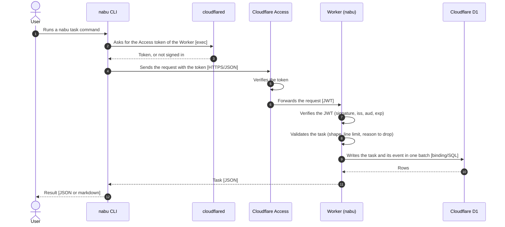
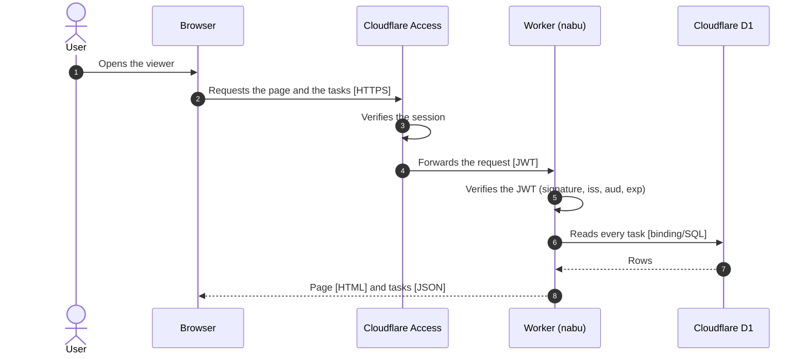
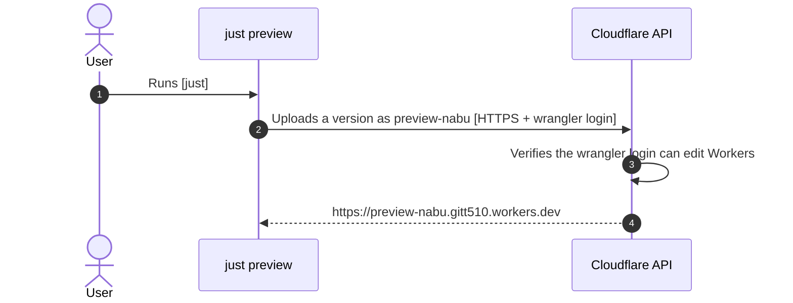
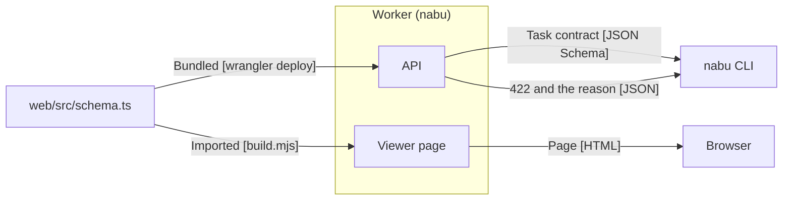

# Architecture

## nabu task

## Viewer

## Preview

## Task contract

- `web/src/schema.ts` defines every rule a task must meet
- The API refuses every write that breaks the task contract
- The API serves the task contract at `/api/schema`
- The viewer page takes the task contract from `web/src/schema.ts` at build
