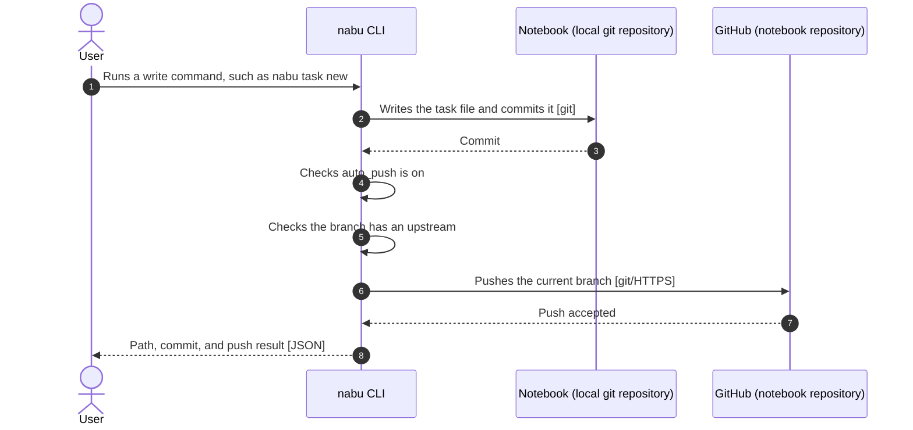
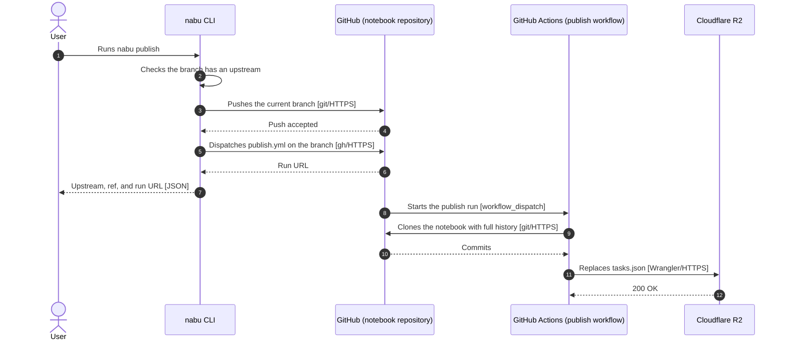
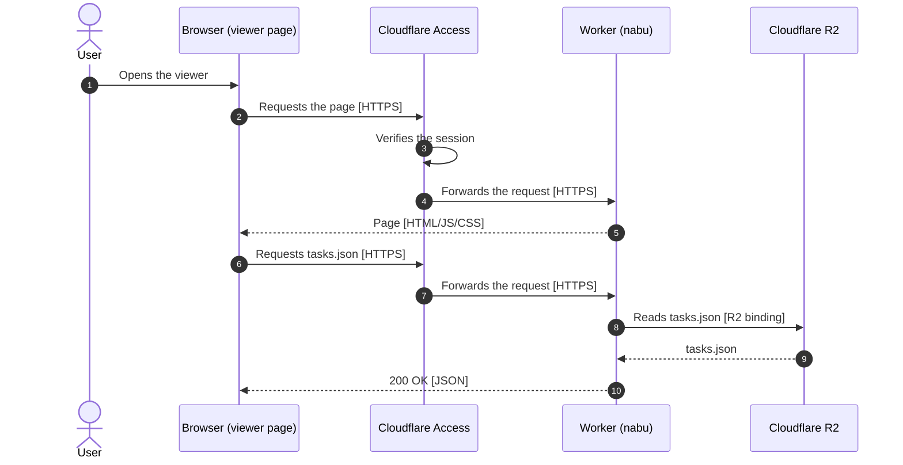
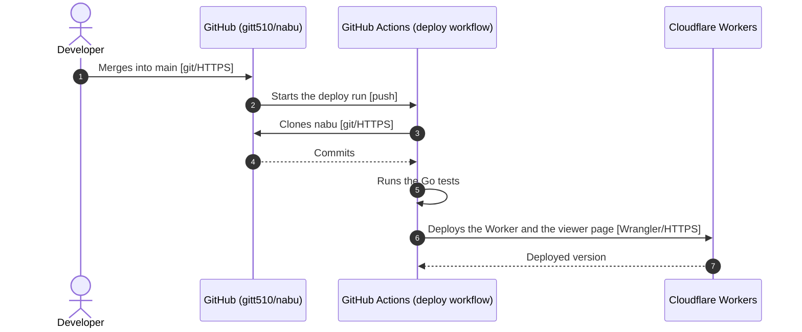

# Architecture

- Each route below is a C4 dynamic diagram at the level of people, containers, and external systems

## Task write with auto_push

## nabu publish

- The nightly schedule starts the same route from step 8

## Viewer reads tasks

## Viewer deploy

