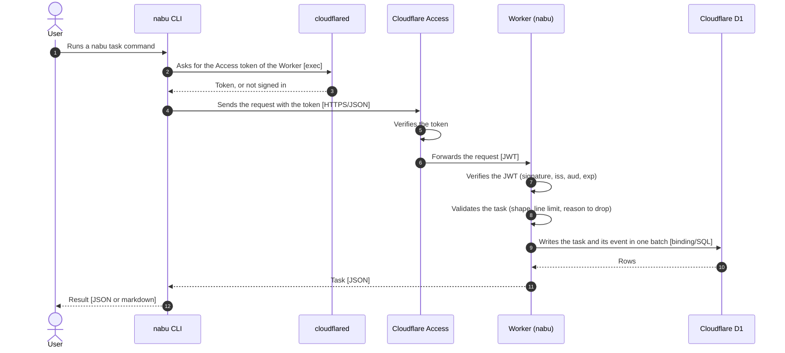
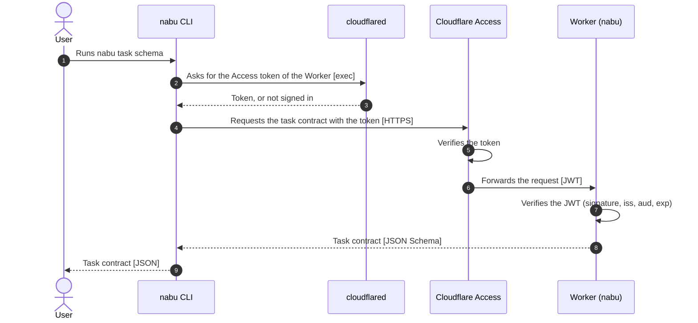
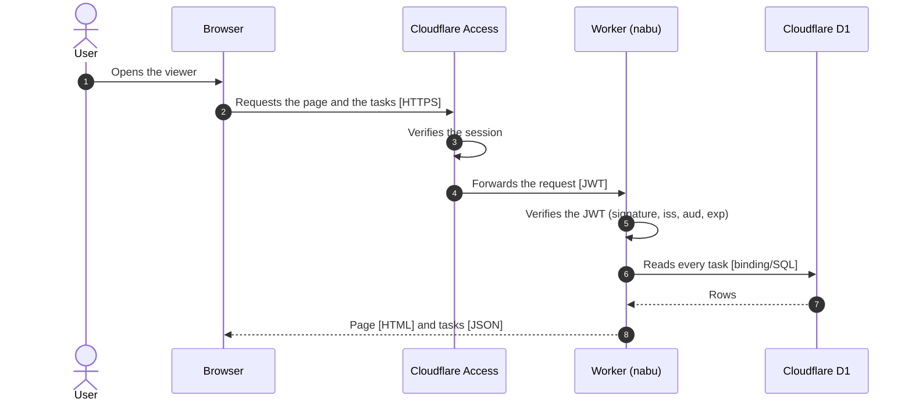
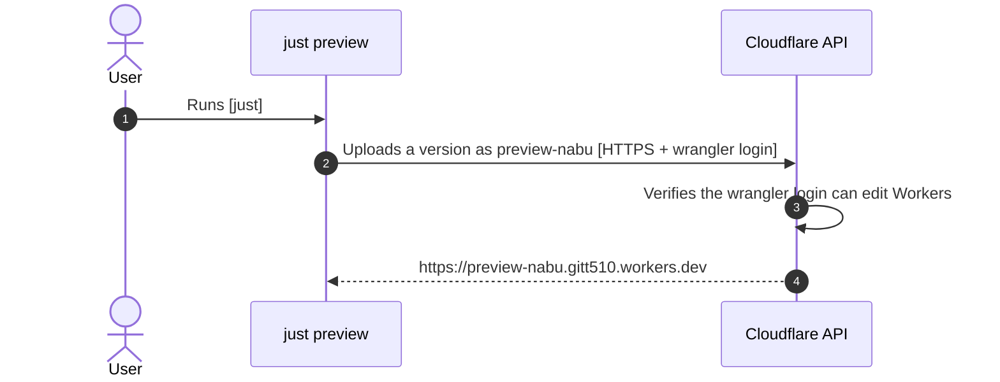

# Architecture

## nabu task

## nabu task schema

## Viewer

## Preview

## Sources

| File | Root of |
|---|---|
| `web/src/schema.ts` | Task contract |
| `web/src/index.ts` | Worker and API |
| `web/build.mjs` | Viewer page |
| `main.go` | nabu CLI |

- `web/src/schema.ts` is the only file that defines a rule a task must meet
- The Worker serves the contract at `/api/schema` and refuses every write that breaks it
- `web/build.mjs` reads the contract from `web/src/schema.ts` when it builds the page
